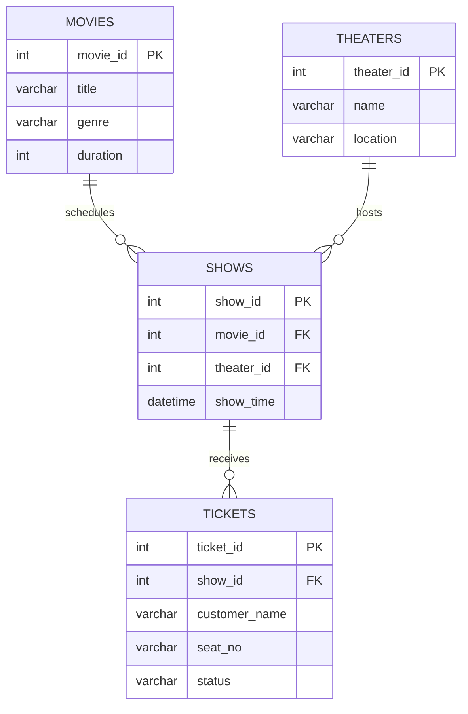

# 🎬 CineBook-DBMS — Movie Theater Booking System

A Database Management Systems (DBMS) case study and mini project developed using **MariaDB and SQL** to manage movies, theaters, show schedules, and ticket bookings. The project demonstrates relational database design, CRUD operations, primary and foreign keys, SQL joins, indexing, and additional SQL queries.

---

## 📌 Table of Contents

- [Project Overview](#-project-overview)
- [Objectives](#-objectives)
- [Technologies Used](#-technologies-used)
- [Features](#-features)
- [Database Schema](#-database-schema)
- [Entity Relationship Diagram](#-entity-relationship-diagram)
- [Database Setup](#-database-setup)
- [Sample Data](#-sample-data)
- [SQL Operations](#-sql-operations)
- [SQL Joins](#-sql-joins)
- [Indexing](#-indexing)
- [Sample Query Results](#-sample-query-results)
- [Additional Queries](#-additional-queries)
- [Project Structure](#-project-structure)
- [How to Run](#-how-to-run)
- [Learning Outcomes](#-learning-outcomes)
- [Limitations](#-limitations)
- [Future Enhancements](#-future-enhancements)
- [License](#-license)

## 🎯 Project Overview

CineBook-DBMS is a relational database project designed to manage the core operations of a movie theater booking system.

The database maintains information about movies, theaters, scheduled shows, and customers' ticket bookings. SQL queries are used to insert, retrieve, update, and delete records, as well as retrieve related information across multiple tables.

This project is developed as part of a DBMS case study and mini project to demonstrate the practical application of database concepts.

## 🎯 Objectives

- Design a relational database for a cinema booking system.
- Store and manage movie and theater information.
- Schedule movie screenings at different theaters.
- Maintain customer ticket and seat information.
- Establish relationships using primary keys and foreign keys.
- Perform CRUD operations using SQL.
- Retrieve information using INNER JOIN and LEFT JOIN.
- Demonstrate database indexing.
- Practice basic and advanced SQL queries.
- Understand how relational databases organize and maintain data.

## 🛠️ Technologies Used

| Technology | Purpose |
|---|---|
| MariaDB | Relational database management system |
| SQL | Database creation, querying, and modification |
| Git | Version control |
| GitHub | Source code hosting and project documentation |

## ✨ Features

- **Movie Management:** Store movie titles, genres, and durations.
- **Theater Management:** Maintain theater names and locations.
- **Show Scheduling:** Associate movies with theaters and show timings.
- **Ticket Management:** Store customer names, seat numbers, and booking statuses.
- **CRUD Operations:** Create, read, update, and delete database records.
- **Relational Queries:** Retrieve related information from multiple tables.
- **SQL Joins:** Demonstrate INNER JOIN and LEFT JOIN.
- **Indexing:** Create indexes on frequently queried columns.
- **Extended Query Collection:** Include additional SQL queries for the DBMS case study.

## 🗄️ Database Schema

**Database name:** `movie_booking`

The project contains four relational tables.

### 1. Movies

Stores information about movies.

| Column | Data Type | Description |
|---|---|---|
| `movie_id` | INT | Primary key; auto-incremented |
| `title` | VARCHAR(100) | Movie title |
| `genre` | VARCHAR(50) | Movie genre |
| `duration` | INT | Duration in minutes |

### 2. Theaters

Stores theater details.

| Column | Data Type | Description |
|---|---|---|
| `theater_id` | INT | Primary key; auto-incremented |
| `name` | VARCHAR(100) | Theater name |
| `location` | VARCHAR(100) | Theater location |

### 3. Shows

Stores scheduled screenings.

| Column | Data Type | Description |
|---|---|---|
| `show_id` | INT | Primary key; auto-incremented |
| `movie_id` | INT | Foreign key referencing `movies(movie_id)` |
| `theater_id` | INT | Foreign key referencing `theaters(theater_id)` |
| `show_time` | DATETIME | Date and time of the screening |

### 4. Tickets

Stores customer ticket bookings.

| Column | Data Type | Description |
|---|---|---|
| `ticket_id` | INT | Primary key; auto-incremented |
| `show_id` | INT | Foreign key referencing `shows(show_id)` |
| `customer_name` | VARCHAR(100) | Customer name |
| `seat_no` | VARCHAR(10) | Seat number |
| `status` | VARCHAR(20) | Booking status |

### Key Constraints

- **PRIMARY KEY:** Uniquely identifies each record.
- **FOREIGN KEY:** Connects records between related tables.
- **AUTO_INCREMENT:** Automatically generates numeric IDs.
- **INDEX:** Helps MariaDB locate records efficiently for suitable queries.

## 🔗 Entity Relationship Diagram

The following ER diagram represents the relationships between the four tables.



### Relationship Explanation

- One movie can have multiple scheduled shows.
- One theater can host multiple shows.
- One show can have multiple ticket records.
- Each show references one movie and one theater.
- Each ticket references one show.

## ⚙️ Database Setup

Create the database and select it:

```sql
CREATE DATABASE movie_booking;
USE movie_booking;
```

### Create the Movies Table

```sql
CREATE TABLE movies (
    movie_id INT AUTO_INCREMENT PRIMARY KEY,
    title VARCHAR(100),
    genre VARCHAR(50),
    duration INT
);
```

### Create the Theaters Table

```sql
CREATE TABLE theaters (
    theater_id INT AUTO_INCREMENT PRIMARY KEY,
    name VARCHAR(100),
    location VARCHAR(100)
);
```

### Create the Shows Table

```sql
CREATE TABLE shows (
    show_id INT AUTO_INCREMENT PRIMARY KEY,
    movie_id INT,
    theater_id INT,
    show_time DATETIME,
    FOREIGN KEY (movie_id) REFERENCES movies(movie_id),
    FOREIGN KEY (theater_id) REFERENCES theaters(theater_id)
);
```

### Create the Tickets Table

```sql
CREATE TABLE tickets (
    ticket_id INT AUTO_INCREMENT PRIMARY KEY,
    show_id INT,
    customer_name VARCHAR(100),
    seat_no VARCHAR(10),
    status VARCHAR(20),
    FOREIGN KEY (show_id) REFERENCES shows(show_id)
);
```

## 📝 Sample Data

The following records can be used to test the database.

### Movies

```sql
INSERT INTO movies (title, genre, duration) VALUES
('Inception', 'Sci-Fi', 148),
('Interstellar', 'Sci-Fi', 169),
('The Dark Knight', 'Action', 152);
```

### Theaters

```sql
INSERT INTO theaters (name, location) VALUES
('PVR Cinemas', 'Coimbatore'),
('INOX', 'Chennai');
```

### Shows

```sql
INSERT INTO shows (movie_id, theater_id, show_time) VALUES
(1, 1, '2026-10-14 18:00:00'),
(2, 1, '2026-10-14 21:00:00'),
(3, 2, '2026-10-15 19:00:00');
```

### Tickets

```sql
INSERT INTO tickets (show_id, customer_name, seat_no, status) VALUES
(1, 'Alice', 'A1', 'Confirmed'),
(1, 'Bob', 'A2', 'Confirmed'),
(2, 'Charlie', 'B1', 'Pending'),
(3, 'David', 'C3', 'Confirmed');
```

## 🧩 SQL Operations

The project demonstrates the four basic CRUD operations.

### 1. CREATE — Insert Records

```sql
INSERT INTO movies (title, genre, duration)
VALUES ('The Matrix', 'Sci-Fi', 136);
```

### 2. READ — Retrieve Records

```sql
SELECT * FROM movies;
SELECT * FROM theaters;
SELECT * FROM shows;
SELECT * FROM tickets;
```

### 3. UPDATE — Modify Records

Confirm a pending ticket:

```sql
UPDATE tickets
SET status = 'Confirmed'
WHERE customer_name = 'Charlie'
  AND seat_no = 'B1';
```

### 4. DELETE — Remove Records

Cancel Bob's ticket:

```sql
DELETE FROM tickets
WHERE customer_name = 'Bob'
  AND seat_no = 'A2';
```

**Note:** The sample UPDATE and DELETE statements modify the stored data. Execute them on test data or a database copy if you need to preserve the original sample records.

## 🔍 SQL Joins

### INNER JOIN

Retrieves movie, theater, show, and ticket details when matching records exist in all four tables.

```sql
SELECT
    m.title,
    th.name AS theater,
    s.show_time,
    tk.customer_name,
    tk.seat_no,
    tk.status
FROM tickets tk
INNER JOIN shows s
    ON tk.show_id = s.show_id
INNER JOIN movies m
    ON s.movie_id = m.movie_id
INNER JOIN theaters th
    ON s.theater_id = th.theater_id;
```

### LEFT JOIN

Retrieves all scheduled shows, including shows without ticket records.

```sql
SELECT
    m.title,
    th.name AS theater,
    s.show_time,
    tk.customer_name,
    tk.seat_no
FROM shows s
LEFT JOIN tickets tk
    ON s.show_id = tk.show_id
JOIN movies m
    ON s.movie_id = m.movie_id
JOIN theaters th
    ON s.theater_id = th.theater_id;
```

The LEFT JOIN preserves shows without tickets. The joins to `movies` and `theaters` are INNER JOINs, so the referenced movie and theater must exist.

### Tickets for a Specific Movie

```sql
SELECT
    m.title,
    th.name AS theater,
    tk.customer_name,
    tk.seat_no,
    tk.status
FROM movies m
JOIN shows s
    ON m.movie_id = s.movie_id
JOIN tickets tk
    ON s.show_id = tk.show_id
JOIN theaters th
    ON s.theater_id = th.theater_id
WHERE m.title = 'Inception';
```

## ⚡ Indexing

Indexes are created to support queries that filter records by commonly used columns.

```sql
CREATE INDEX idx_movie
ON shows(movie_id);

CREATE INDEX idx_theater
ON shows(theater_id);

CREATE INDEX idx_show
ON tickets(show_id);
```

### Example Queries

```sql
SELECT * FROM shows
WHERE movie_id = 1;

SELECT * FROM shows
WHERE theater_id = 2;

SELECT * FROM tickets
WHERE show_id = 1;
```

### Why Indexing Matters

- Can improve retrieval performance for suitable queries.
- Helps MariaDB locate matching rows without always scanning an entire table.
- Adds storage overhead and may slow down inserts, updates, and deletes.
- Actual performance depends on the data, query, and execution plan.

Use `EXPLAIN` to inspect how MariaDB executes a query:

```sql
EXPLAIN
SELECT * FROM shows
WHERE movie_id = 1;
```

## 📊 Sample Query Results

With the supplied sample data, the following are expected:

| Query | Expected Result |
|---|---|
| `SELECT * FROM movies;` | 3 movie records |
| `SELECT * FROM theaters;` | 2 theater records |
| `SELECT * FROM shows;` | 3 show records |
| `SELECT * FROM tickets;` | 4 ticket records before UPDATE or DELETE |
| Tickets for Inception | Alice and Bob's bookings before deletion |
| Ticket status for Charlie | Pending before UPDATE; Confirmed after UPDATE |

The sample show dates are fixed demonstration data and may be in the past when the project is run.

## 📚 Additional Queries

The project also includes an extended collection of SQL queries for the DBMS case study.

Organize the additional queries by topic wherever applicable:

- Basic SELECT statements
- Filtering with `WHERE`
- Sorting with `ORDER BY`
- Grouping with `GROUP BY`
- Aggregate functions such as `COUNT`, `SUM`, `AVG`, `MIN`, and `MAX`
- Pattern matching with `LIKE`
- Range and membership conditions using `BETWEEN` and `IN`
- INNER, LEFT, and other relevant joins
- Subqueries and nested queries
- UPDATE and DELETE operations
- Indexing and query analysis
- Other advanced SQL concepts covered in the case study

**Total query count:** 40+ additional queries, alongside the core setup, sample-data, CRUD, join, and indexing examples. Update this count if your final query collection differs.


## 🚀 How to Run

### Prerequisites

- MariaDB Server installed and running.
- MariaDB command-line client or a database GUI such as HeidiSQL, DBeaver, or another compatible client.
- The SQL files from this repository.

### Steps

1. Clone or download the repository.
2. Open your MariaDB client.
3. Execute the database creation and table definitions.
4. Insert the sample data after creating the tables.
5. Run the CRUD, JOIN, indexing, and additional query scripts.
6. Verify the results in your SQL client.

Example using the MariaDB command-line client:

```bash
mariadb -u your_username -p
```

Then run your SQL file from the MariaDB prompt:

```sql
SOURCE /path/to/schema.sql;
```

Replace the example path with the actual location of your file. If your schema and sample data are in separate files, execute them in the correct order.

## 🎓 Learning Outcomes

Through this project, the following DBMS concepts are demonstrated:

- Relational database creation and management.
- Table design and data types.
- Primary and foreign key constraints.
- Relationships between database tables.
- CRUD operations.
- SQL joins and multi-table queries.
- Database indexing and query execution plans.
- Data retrieval, modification, and deletion.
- Practical SQL application in a real-world-inspired scenario.

## ⚠️ Limitations

- The project focuses on database operations rather than a complete customer-facing booking application.
- It does not include a payment gateway or user authentication.
- Seat availability and duplicate-seat booking prevention are not enforced by the current schema.
- The ticket status column accepts ordinary text; permitted statuses are not restricted by a CHECK constraint.
- Transaction handling and concurrent booking logic are not implemented in the supplied schema.
- The sample data is intended for demonstration and testing.

## 🔮 Future Enhancements

- Add user accounts and authentication.
- Add ticket pricing and payment details.
- Prevent duplicate bookings for the same seat and show using an appropriate database constraint.
- Add seat availability and cancellation workflows.
- Add booking timestamps and transaction handling.
- Add stored procedures, triggers, and views.
- Introduce CHECK constraints or lookup tables for valid booking statuses.
- Add a frontend using HTML, CSS, and JavaScript.
- Connect a backend application to MariaDB.
- Add automated tests for database operations.

## 👨‍💻 Contributors

Developed as a DBMS case study and mini project.

Add contributor names and GitHub profile links here if this is a team project.

## 📄 License

This project is intended for educational and academic purposes. Add a license file if you want to specify the terms under which others may reuse or distribute the code.

---

**CineBook-DBMS** — A practical demonstration of relational database design and SQL operations for a movie theater booking system.
